<p align="center">
  
</p>

<p align="center">
  <a href="https://manecist.github.io/">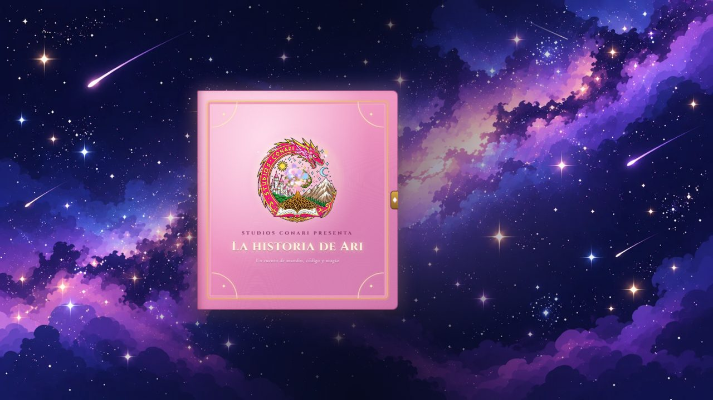</a>
</p>

<h1 align="center">✦ Portafolio · María Inés Cisterna Escobar ✦</h1>

<p align="center">
💜 Fundadora de <b>Studios Conari SpA</b> · Desarrolladora Full Stack Java · Diseño y producción digital · Análisis de datos · Matrona 💜
</p>

<p align="center">
✨ <a href="https://manecist.github.io/"><strong>Abrir el portafolio en línea</strong></a> ✨<br>
<sub>Funciona en el navegador, sin instalar nada · computador y celular · modo día y noche</sub>
</p>

<p align="center">
  
  
  
  
  
  
  
  
</p>

<p align="center">
<a href="#recorrido">📖 Cómo se recorre</a> · <a href="#version-clasica">✦ Versión clásica</a> · <a href="#desarrollo">💻 Desarrollo</a> · <a href="#datos">📊 Datos de salud</a> · <a href="#matrona">🩺 Matrona hoy</a> · <a href="#ilustracion">🎨 Ilustración</a> · <a href="#arcade">🕹️ Arcade</a> · <a href="#estructura">🗂️ Estructura</a>
</p>

---

## 🧠 De qué se trata

Mi portafolio no es una lista de proyectos: es **un libro mágico que se puede recorrer**. Cuenta cómo pasé de la salud a la tecnología y al diseño, y en cada capítulo hay algo que se puede **probar de verdad**: una calculadora en Java, una caja registradora, una tienda en vivo, un banco de evaluaciones, tableros de salud, mis cápsulas como matrona, mis ilustraciones y tres juegos.

🩺 Cinco años como matrona · 💻 Formación Full Stack Java · 🎨 Ilustración original · 📊 Datos públicos explicados · 🏢 Fundadora de Studios Conari SpA

---

<a id="recorrido"></a>

## 📖 Cómo se recorre

| | Momento | Qué pasa |
|:-:|---|---|
| ✨ | **Intro de Studios Conari** | El hada dibuja y pinta los emblemas del estudio y al dragón rosa, que revela STUDIOS CONARI. Cualquier tecla o toque la salta. |
| 📕 | **El libro mágico** | Una estela cruza el cielo, aparece el libro y el hada lo abre con su varita. Ahí eliges cómo conocer la historia. |
| 📖 | **Leer el cuento** | El portafolio contado página a página, con hojas que giran, escenas animadas, narrador y pop-ups. |
| ✦ | **Versión clásica** | Todo el portafolio por escenas, con el reino de fondo en paralaje. |
| ☀️🌙 | **Modo día y noche** | El botón ☀/☾ cambia el tema y el reino pasa del día a la noche. Al principio sigue la preferencia del sistema. |

<table align="center">
<tr>
<td align="center"><b>📕 El libro de noche</b><br></td>
<td align="center"><b>☀️ El libro de día</b><br>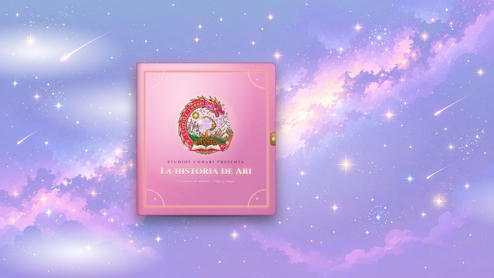</td>
</tr>
<tr>
<td align="center"><b>🧭 ¿Cómo quieres conocer esta historia?</b><br>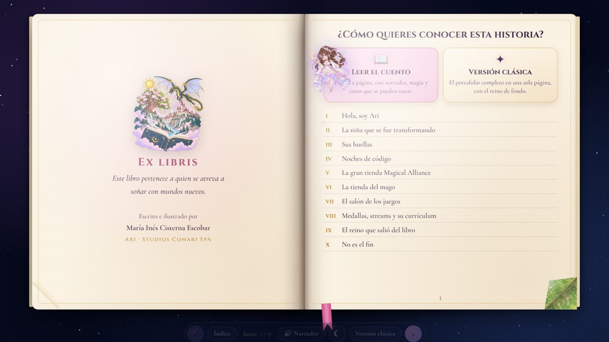</td>
<td align="center"><b>🎨 Un capítulo del cuento</b><br>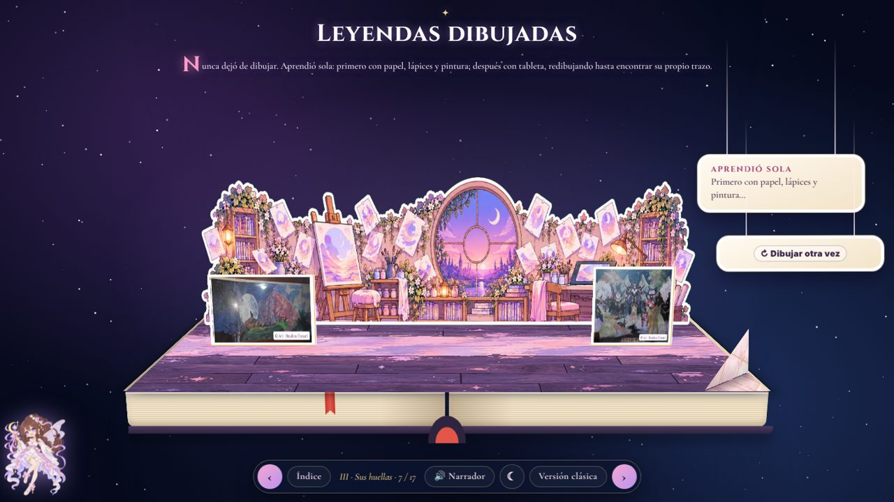</td>
</tr>
</table>

---

<a id="version-clasica"></a>

## ✦ Versión clásica

Al elegirla, la escena del reino aparece en **lineart en blanco y negro** y el hada la **pinta en acuarela**: primero la pareja y el árbol, luego el mago y el dragón, y el cielo se abre con un hechizo desde la luna (o desde el sol, de día). Después queda como fondo en **paralaje por capas** que se mueven con el puntero, con pétalos de sakura.

La página no se desplaza: cada giro de la rueda pasa a la escena siguiente y, al entrar a cada sección grande, el hada cruza la pantalla con su estela.

<p align="center">
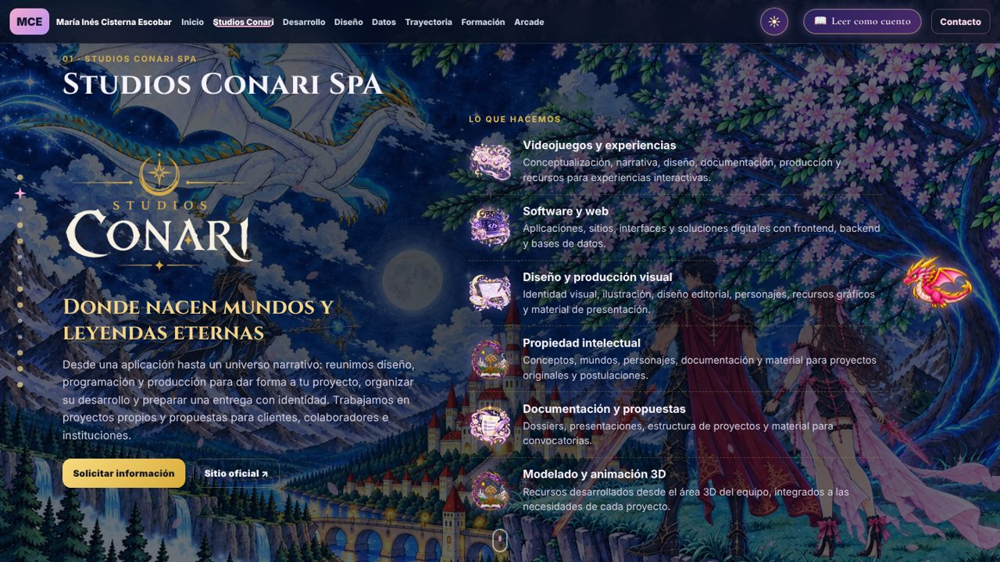
</p>

---

<a id="desarrollo"></a>

## 💻 Desarrollo · programación que se puede probar

| | Demostración | Qué se puede hacer |
|:-:|---|---|
| 🧮 | **Calculadora encantada** | Teclado completo (también con el teclado físico) y, al lado, el mismo cálculo escrito en Java. |
| 🧾 | **Caja registradora · M4** | Los 68 productos de [Ecommerce-Backend-M4](https://github.com/manecist/Ecommerce-Backend-M4), descuento de 0 a 100 %, boleta impresa y cajón con el vuelto. |
| 🛍️ | **Magical Alliance · M7** | Mi proyecto final Full Stack Java, en vivo dentro del portafolio: [vitrina interactiva](https://manecist.github.io/Ecommerce-Portafolio-Final-M7/). |
| 📝 | **Banco de Evaluaciones** | Demo técnico en TypeScript, React, Node.js y PostgreSQL, en vivo: redacción guiada, revisión, pruebas en papel o Moodle y análisis de ítems. [Abrir el demo](https://manecist.github.io/banco-evaluaciones-demo/). |

<table align="center">
<tr>
<td align="center"><b>🧮 Calculadora, caja y tienda</b><br>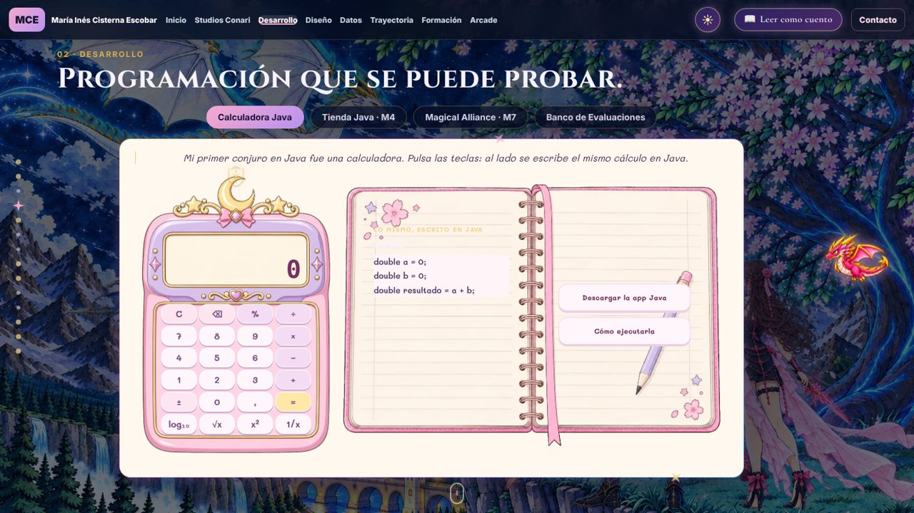</td>
<td align="center"><b>📝 Banco de Evaluaciones en vivo</b><br>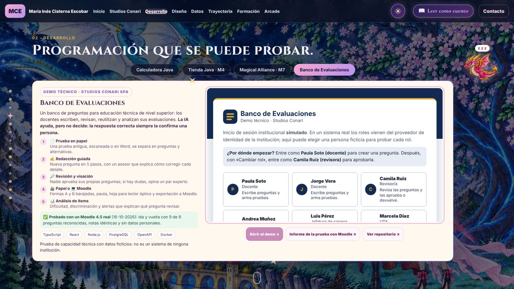</td>
</tr>
</table>

---

<a id="datos"></a>

## 📊 Datos de salud que se entienden

Cinco tableros que hice como matrona en **Power BI y Tableau** con datos públicos de Chile. En el portafolio se elige un tema y se recorre:

- 🔍 **Lo que encontré:** qué investigué, lo que observé y lo que concluyo.
- 📐 **Indicadores (KPI):** cada uno con su valor en Chile, cómo se calcula, qué evalúa, por qué importa y su meta.
- 🖼️ **Cada página del tablero** en Power BI o en Tableau, con vista ampliada.
- 🏫 **Simulador** de matronas en los colegios (ITS y embarazo adolescente).
- 📁 **Archivos** para descargar: `.pbix`, `.twbx` y la base de datos en Excel.

| | Tablero | Pregunta |
|:-:|---|---|
| 💊 | Anticonceptivos en Chile | ¿Qué método me sirve, qué tan eficaz y seguro es? |
| 🩺 | ITS en Chile | ¿Están aumentando y dónde está Chile frente al mundo? |
| 🤰 | Embarazo y matronería | ¿Qué pasa con el embarazo adolescente y las matronas? |
| 🍼 | Ajuar Chile Crece Contigo | ¿Llega el ajuar a todas las guaguas y cuánto cuesta? |
| 🎗️ | Cáncer en Chile | ¿Cuánto aumenta y cómo le ganamos? |

<p align="center">
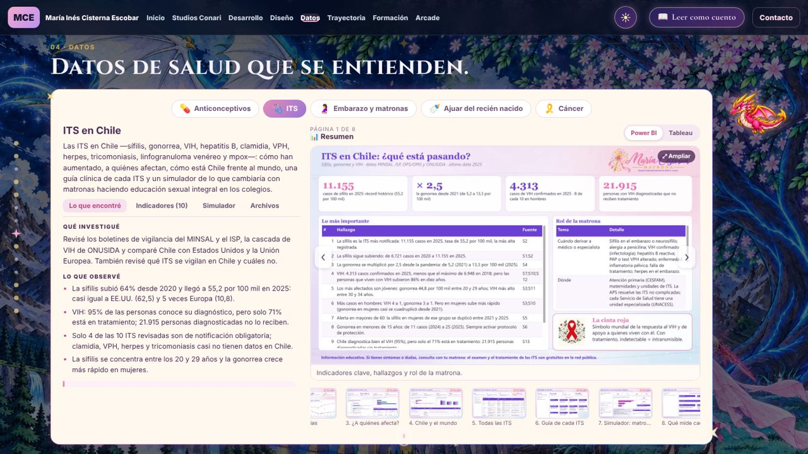
</p>

<sub>📂 Tableros completos: [Analisis-de-datos-dashboards](https://github.com/manecist/Analisis-de-datos-dashboards)</sub>

---

<a id="matrona"></a>

## 🩺 Matrona hoy

Lo que explico en la consulta, ahora en video y en páginas que se pueden usar:

| | Qué hay | |
|:-:|---|---|
| 🎬 | **8 cápsulas nuevas en video (2026)** y la cápsula de Chile Crece Contigo (2020) | Se reproducen dentro del portafolio: leche materna, Shantala, chanchitos, sueño seguro, maternidad, PAP, píldora del día después y mitos de la lactancia. |
| 🗺️ | **Páginas interactivas en vivo** | Cápsula Chile Crece Contigo, Anticonceptivos al toque, Torpedo profesional, Cáncer, ITS, Matronas y mi tesis. |
| 🧾 | **Planilla PAP** | La planilla Excel con macros que armé para el CESFAM (datos 100 % ficticios). |

<p align="center">
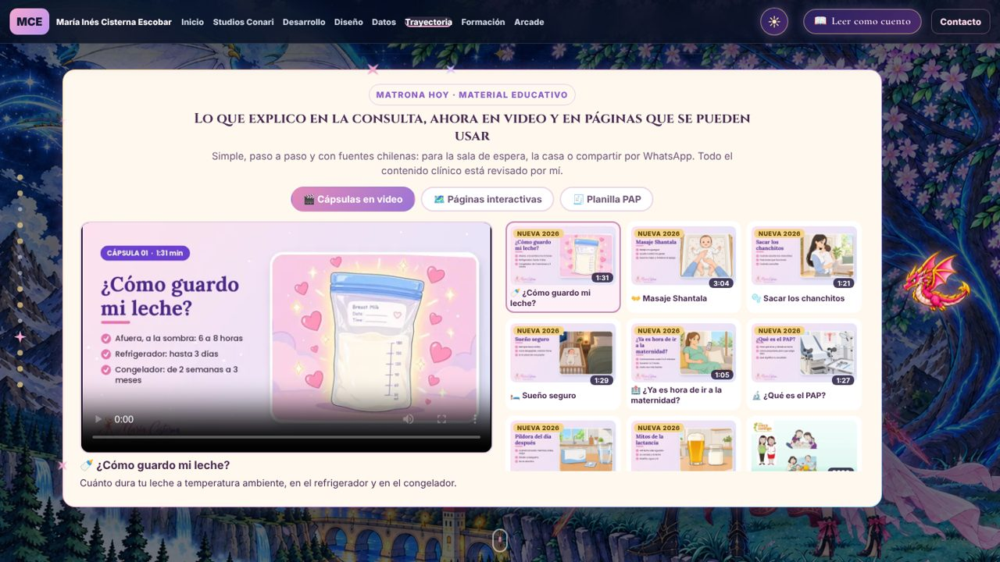
</p>

<sub>📂 Portafolio de matrona: [Matrona](https://github.com/manecist/Matrona) · <a href="https://manecist.github.io/Matrona/">verlo en línea</a></sub>

---

<a id="ilustracion"></a>

## 🎨 Leyendas dibujadas

Ilustraciones originales de criaturas y espíritus de Chile y los Andes —Alicanto, Achachila, Supai, Láscar, La Tirana, Make-Make, Pachamama y más—, con procesos de lineart y obras de regalo. Todas llevan **marca de agua incrustada**, sin menú contextual ni arrastre, y se ven en un visor ampliado.

<p align="center">
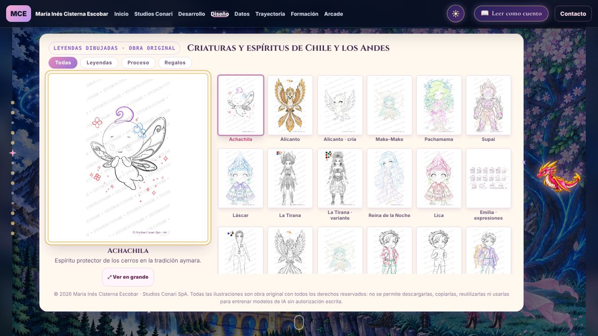
</p>

---

<a id="arcade"></a>

## 🕹️ Arcade mágico

| | Juego | |
|:-:|---|---|
| 🧱 | **Bloques encantados** | Tetris con gemas, cielo estrellado y el hada al completar una línea. |
| 💎 | **Jardín de gemas lunares** | Combina tres o más gemas iguales. |
| 🌌 | **Cielo de constelaciones** | Une las estrellas de diez constelaciones reales. |

<p align="center">
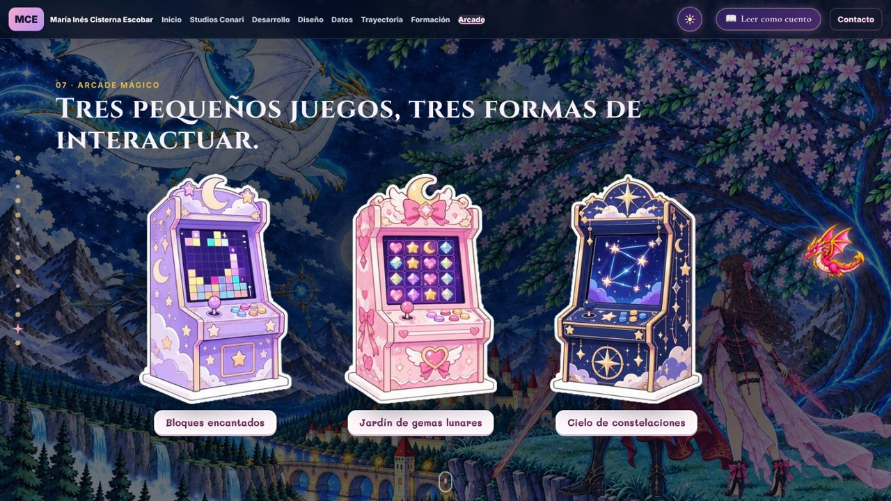
</p>

---

<a id="estructura"></a>

## 🗂️ Estructura

```text
manecist.github.io/
├── index.html            🏠 página completa: libro, cuento y versión clásica
├── styles.css            🎨 estilos generales
├── libro.css · libro.js  📕 el libro mágico y el modo cuento
├── cuento.js             📖 escenas animadas del cuento
├── escenas.css · .js     ✦ versión clásica por escenas
├── fondo-acuarela.js     🌸 el reino: del lineart a la acuarela, en paralaje
├── secciones.js          🧮 calculadora, leyendas, reino y tienda del mago
├── salud.css · salud.js  📊 tableros de salud, matrona hoy y banco de evaluaciones
├── datos-salud.js        🗃️ datos de los cinco tableros
├── app.js · tetris.js    🕹️ caja registradora, juegos y constelaciones
├── intro.*               ✨ intro animada de Studios Conari
├── tema-claro.css        ☀️ modo día
├── java/                 ☕ aplicación de escritorio en Java (Swing)
└── assets/               🖼️ ilustraciones, reino, tableros, cápsulas y capturas
```

---

## 🛠️ Verlo en local

1. Descarga el repositorio: **Code → Download ZIP** y descomprímelo.
2. Abre una terminal en la carpeta y ejecuta `python -m http.server`.
3. Entra a `http://localhost:8000`.

> 💡 Al cambiar un archivo `.css` o `.js`, sube el número `?v=` de su enlace en `index.html` para que el navegador no muestre una copia guardada.

---

## 📚 Fuentes y créditos

- 🛒 Catálogo M4 y capturas M7: repositorios de [manecist](https://github.com/manecist).
- 🌌 Constelaciones: coordenadas de [d3-celestial](https://github.com/ofrohn/d3-celestial) (Olaf Frohn, BSD-3-Clause; ver [LICENCIAS.txt](LICENCIAS.txt)) y figuras de la [IAU](https://iauarchive.eso.org/public/themes/constellations/).
- 📊 Tableros: cifras de MINSAL, DEIS, INE, ISP, OMS y otras fuentes públicas, citadas en cada base de datos.
- ✨ Animación: [GSAP](https://gsap.com) (licencia estándar sin costo).
- 🎨 Identidad visual, ilustraciones, cuento y personajes: Studios Conari SpA y María Inés Cisterna Escobar.

---

## ©️ Licencia

© 2026 María Inés Cisterna Escobar y Studios Conari SpA. **Todos los derechos reservados.** Ilustraciones, personajes, textos, diseño y código son obra original: no se permite copiarlos, reutilizarlos ni usarlos para entrenar modelos sin autorización escrita. Detalles en [LICENSE](LICENSE).

<p align="center">
👩‍💻 <b>María Inés Cisterna Escobar</b> · Studios Conari SpA · Concepción, Chile
</p>
